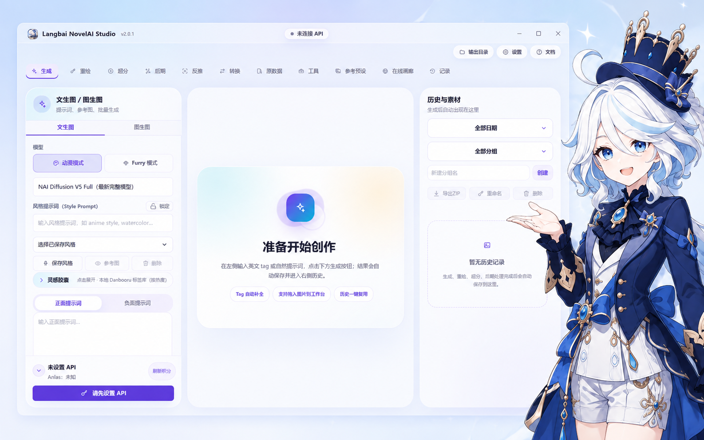
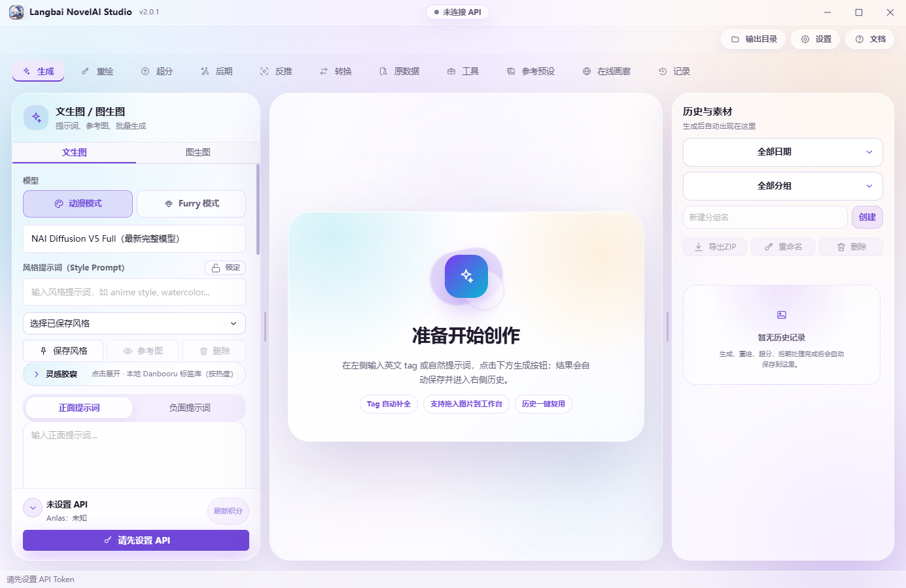
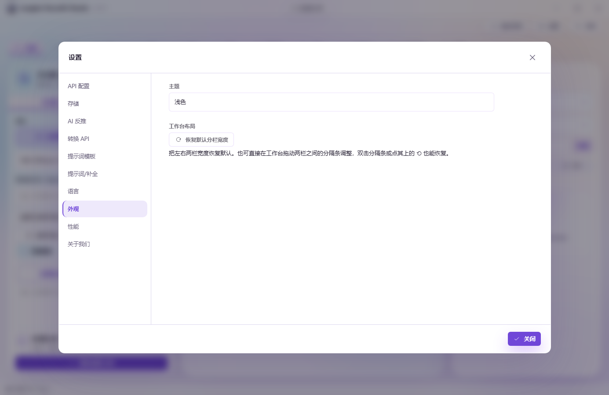

<!-- release-summary: current-version-only; downloads: Latest -->
# Langbai NovelAI Studio

> [Latest](https://github.com/OldLi1337/novelai-image-desktop/releases/latest) 提供目前的發行說明與實際附件；安裝方式與限制請見下方下載區。

[简体中文](./README.md) · [繁體中文](./README.zh-TW.md) · [English](./README.en.md) · [日本語](./README.ja.md) · [한국어](./README.ko.md)


### 從一句靈感，到一組作品。

NovelAI 圖像創作工作臺，介面支援簡體中文、繁體中文、英語、日語與韓語。



**[下載最新發行版](https://github.com/OldLi1337/novelai-image-desktop/releases/latest)** · [首次使用教學（簡體中文）](./docs/guide/GETTING_STARTED.md) · [功能指南（簡體中文）](./docs/guide/FEATURES.md)

> 需設定自己的 **NovelAI Persistent API Token**。模型權限與生成費用依 NovelAI 帳號而定。圖片反推、提示詞轉換與酒館等選用 AI 服務需另外設定。

## 本次更新

本 fork 目前的改動以簡體中文記載於 [README](./README.md) 與[更新記錄](./docs/RELEASE_NOTES.md)：NovelAI 官方 1.5× 增強、常駐顯示的提示詞庫（支援追加與標籤）、標籤聯想修正，以及只檢查本 fork 的更新。

## 快速開始

1. 從發行頁下載適合系統的安裝套件。一般使用者不需安裝 Node.js 或執行原始碼建置命令。
2. 開啟「設定 → API 設定」，依軟體內教學取得並填寫 Token，再驗證 Token 或重新整理餘額。
3. 進入「生成」，選擇可用模型、輸入提示詞，確認尺寸、張數與預估費用後生成。桌面端結果會儲存至輸出目錄並加入歷史紀錄。

```text
1girl, solo, blue hair, blue eyes, white dress, garden, sunlight, smile
```

先保留預設參數，成功生成一次後再設定選用服務。介面語言可在設定中切換；使用者提示詞、檔名與對話內容不會被翻譯。

## 依創作任務選擇工具

| 任務 | 功能 | 指南（簡體中文） |
| --- | --- | --- |
| 生成或修改圖片 | 文生圖、圖生圖、角色提示詞與位置 | [生成與修圖](./docs/guide/FEATURES.md#generation) |
| 透過對話構思 | 酒館 AI、確認後生成或自動生成 | [酒館](./docs/guide/FEATURES.md#tavern) |
| 製作連續畫面 | 漫畫生成器、分鏡參數、候選圖、主圖 ZIP | [漫畫](./docs/guide/FEATURES.md#comic) |
| 重用角色與氛圍參考 | 精準參考、氛圍遷移、線上目錄、預設庫 | [角色參考](./docs/guide/FEATURES.md#reference) |
| 探索描述與畫風 | 靈感、反推、轉換、畫風實驗室、個人法典 | [提示詞](./docs/guide/FEATURES.md#prompt) |
| 重用圖片參數 | 中繼資料、圖庫、相容參數匯入 | [參數重用](./docs/guide/FEATURES.md#reuse) |
| 整理作品 | 歷史分組、鎖定種子變體、重新命名、ZIP 匯出 | [管理](./docs/guide/FEATURES.md#manage) |

酒館、漫畫與參考預設有各自的流程。漫畫分鏡可生成多張候選，最後只匯出選定主圖。參考效果取決於模型與參數，不保證結果完全一致。

Windows 本機 Artist Detective 流程目前僅開放 **NAI 4.5 Full**。完整版本機評分模型至少需要 8 GB 顯示記憶體；輕量版供低顯示記憶體裝置試用，尚未驗證通用最低需求。NovelAI 負責雲端生成，本機 CUDA 負責畫風評分。相似度**不是還原百分比**。模型與執行環境需另外下載。

Windows 本機酒館 Agent 經確認後安裝已驗證的相容元件，不直接安裝任意官方新版。使用者新增或修改的外掛會保留，但不保證所有第三方外掛組合都相容。[Agent 更新與復原說明（簡體中文）](./docs/TAVERN_AGENT_UPDATES.md)。

## 介面預覽

以下既有截圖來自 **2026-08-30 / v2.0.1**，用於展示版面，不代表所有現行功能。上方宣傳插畫不是實際功能截圖。



<details><summary>設定預覽</summary>



</details>

## 下載與更新

發行版本、適用平臺、簽署狀態及更新限制以 [Latest 發行頁](https://github.com/OldLi1337/novelai-image-desktop/releases/latest)的最新說明為準。各下載連結皆開啟附件清單，請依下表選擇套件格式。[原始碼（main）](https://github.com/OldLi1337/novelai-image-desktop/tree/main) · [更新紀錄（簡體中文）](./docs/RELEASE_NOTES.md)。

| 平臺 | 在 Latest 選擇的附件 | 說明 |
| --- | --- | --- |
| Windows x64 | [安裝 EXE（Setup）](https://github.com/OldLi1337/novelai-image-desktop/releases/latest) | 選擇安裝版；目前未確認發布者程式碼簽署已完成。 |
| Windows x64 | [可攜 EXE](https://github.com/OldLi1337/novelai-image-desktop/releases/latest) | 下載可攜套件後手動替換。 |
| macOS Intel／Apple 晶片 | [通用 DMG](https://github.com/OldLi1337/novelai-image-desktop/releases/latest) | 目前未確認 Apple 簽署或公證已完成；依系統安全提示與安裝教學處理。 |
| macOS Intel／Apple 晶片 | [通用 ZIP](https://github.com/OldLi1337/novelai-image-desktop/releases/latest) | 選擇通用 ZIP 套件；簽署與公證狀態以 Latest 說明為準。 |
| Linux x64 | [AppImage](https://github.com/OldLi1337/novelai-image-desktop/releases/latest) | 加入執行權限後開啟。 |
| Android | [APK](https://github.com/OldLi1337/novelai-image-desktop/releases/latest) | 從 Latest 附件下載 APK 並手動安裝。 |
| iOS（附加套件） | [未簽名 IPA](https://github.com/OldLi1337/novelai-image-desktop/releases/latest) | 需自行簽署後安裝，無法直接安裝至一般 iPhone。 |

**請手動從 Latest 下載與安裝。** 不能僅靠 GitHub 的 Latest 標記推斷軟體內自動更新可用；是否提供更新清單、版本能否辨識及各平臺更新方式，請確認該次發行的說明。

校驗資料、檔案雜湊及執行紀錄以 [Latest 頁](https://github.com/OldLi1337/novelai-image-desktop/releases/latest)提供的附件或說明為準，下載後請核對對應套件雜湊。尚未完成所有機型的完整實機驗證。

Windows 安裝版與可攜版共用 `%APPDATA%\novelai-image-desktop\`。可攜版**不表示所有資料都存在程式旁**。替換套件前請備份設定與作品。桌面與行動端功能不完全相同，本機畫風迭代僅 Windows 提供。[平臺差異](./docs/guide/FEATURES.md#platforms)。

## 常見問題

- **開源等於免費生成嗎？** 不等於。仍需 NovelAI 帳號、模型權限及額度，實際 Anlas 費用依服務計算；顯示金額為預估。
- **基本生圖需要額外 AI API 嗎？** 不需要。先設定 NovelAI Token 即可。反推、提示詞轉換與對話服務分別設定與計費。
- **讀取 SD／ComfyUI 參數會執行模型嗎？** 不會。中繼資料工具僅讀取及重用相容參數；桌面版另有獨立的本機 ComfyUI 工作臺，須準備並連接實際環境後才能執行支援的工作流程，並非 NovelAI 能執行這些模型。
- **手機只有基本生成嗎？** 不是。另有酒館、漫畫、參考、圖庫、反推與中繼資料工具；各平臺功能仍有差異。

[連線與儲存問題排查（簡體中文）](./docs/guide/GETTING_STARTED.md#troubleshooting)。

## 資料與連線

- 軟體使用 API 連接 NovelAI，不透過網頁自動化或擷取 Cookie。桌面端由 Electron 主程序處理請求，憑證與設定儲存在本機。
- 生成會將提示詞及必要參考圖傳送給 NovelAI。選用 AI 功能會把輸入傳送給你設定的供應商。圖庫、參考目錄與標籤服務各自連接對應來源。
- 中繼資料解析在本機執行，不消耗 Anlas。離線查看參考與詞庫**不等於離線生圖**。
- 提交問題前請移除 Token、API Key、私人對話與敏感圖片。上游診斷日誌可能保留原始語言。

## 開發與交流

桌面端：Electron + React + TypeScript。行動端：Flutter。

[建置教學（簡體中文）](./docs/guide/DEVELOPMENT.md) · [貢獻指南](./CONTRIBUTING.md) · [第三方聲明](./THIRD_PARTY_NOTICES.md) · [MIT 程式碼授權](./LICENSE)

[回報問題](https://github.com/OldLi1337/novelai-image-desktop/issues/new) · [已有問題](https://github.com/OldLi1337/novelai-image-desktop/issues) · QQ 群：**921985070**

看板角色為《原神》芙寧娜。宣傳圖為 AI 生成的非官方同人視覺，與 HoYoverse／NovelAI 無官方合作或背書關係。程式碼 MIT 授權不授予第三方角色、商標或素材權利。[視覺素材紀錄](./docs/assets/readme/ASSETS.md)。
